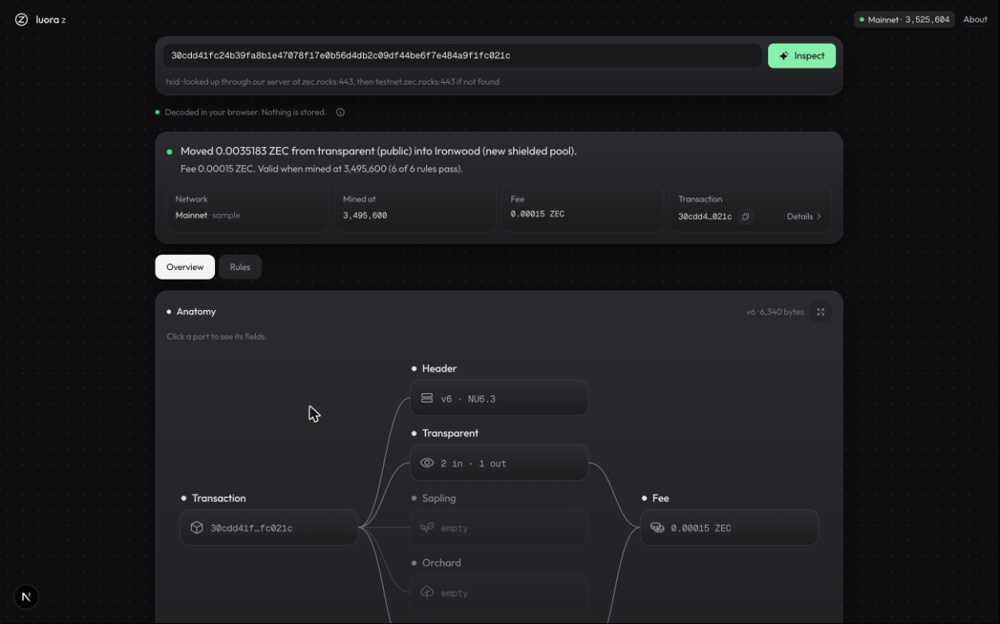
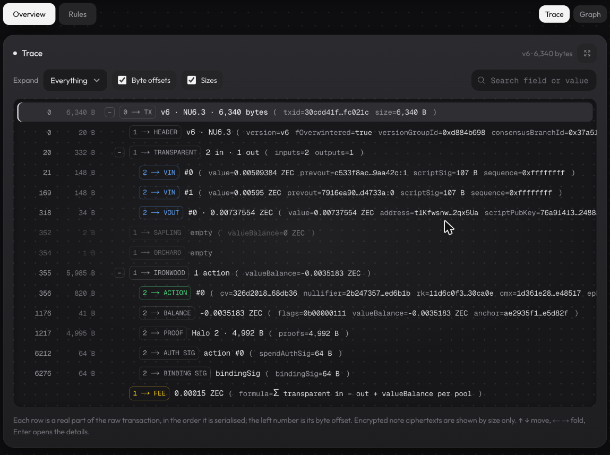
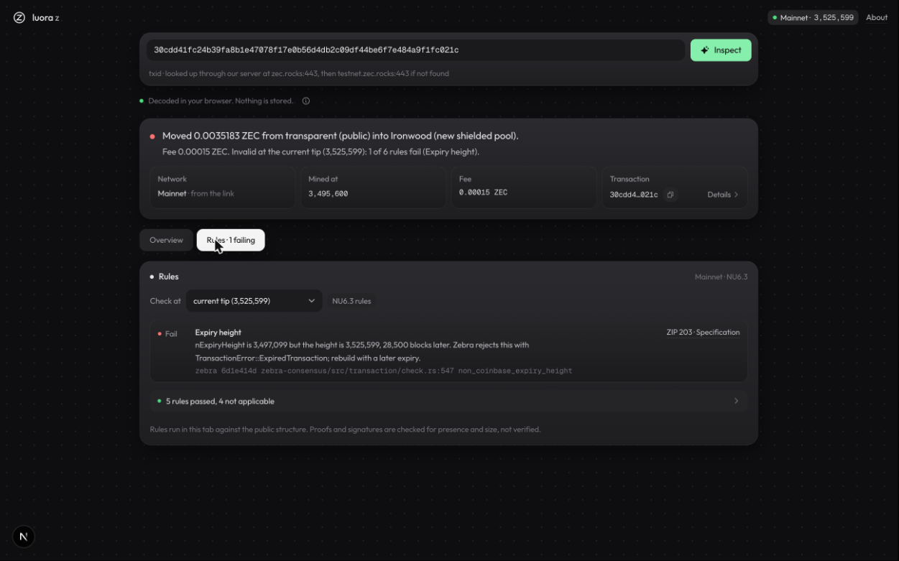
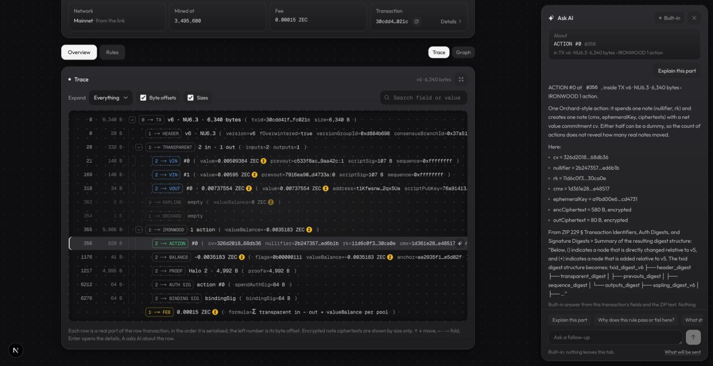
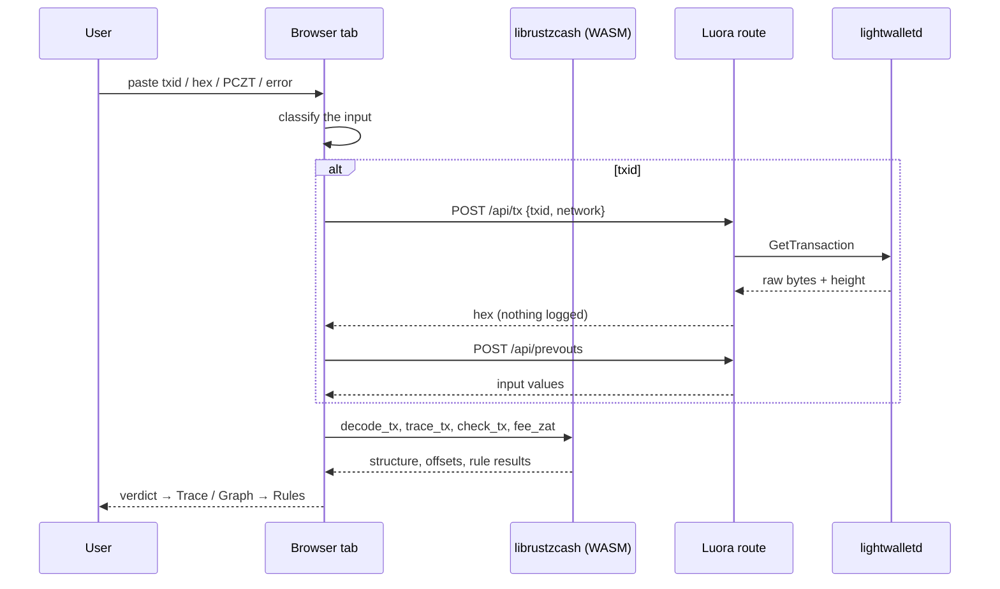
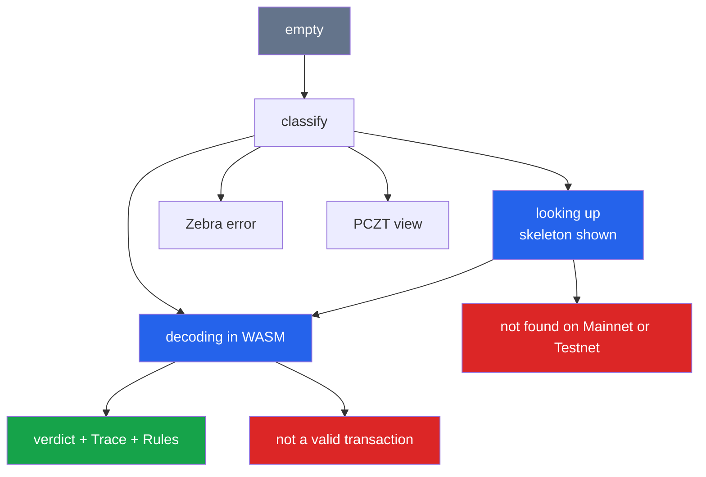

<p align="center">
  
</p>

<h1 align="center">Luora</h1>

<p align="center">
  See what a Zcash transaction actually does. Paste a transaction, a txid, a PCZT or a Zebra error, and get its structure, the consensus rules it passes or breaks, and the reason a node said no. Decoded in your browser. Nothing leaves it.
</p>

<p align="center">
  <a href="https://zec.luorasec.xyz"></a>
  <a href="https://github.com/0xpochita/luora-zecathon"></a>
  
  
  
  
  
  
  
</p>

---

Luora is a transaction inspector for the people who keep Zcash running: **wallet and SDK developers, exchange engineers, Zebra operators and auditors**. NU6.3 Ironwood added the v6 transaction and a fourth value pool, and most tools have not caught up. Luora reads any v4, v5 or v6 transaction with **librustzcash compiled to WebAssembly**, lays it out byte by byte like a debugger trace, checks it against the consensus rules of any height, explains **Zebra's** rejections in plain words, and shows how far a **PCZT** has come through its signing roles.

> **Luora never sees your secrets.** It reads the public shape of a transaction and nothing more.
>
> - Pasted hex and PCZTs are **decoded in your browser tab** and never sent anywhere
> - A txid lookup asks a public **lightwalletd** indexer for that one transaction, through a server route that logs nothing; the txid travels in a POST body, never in a URL
> - **No viewing keys, no wallet, no analytics, no cookies.** Shielded amounts, senders, recipients and memos stay encrypted
> - It is **defensive only**: inspect, explain, verify. No linking, no clustering, no deanonymisation



## Documentation

The project's notes live in this repository:

| Section | Pages |
|---|---|
| How it was built | [Core (librustzcash → WASM)](docs/handoff/core.md) · [Chain data and Zebra catalog](docs/handoff/data.md) · [Web app](docs/handoff/web.md) · [UX and Trace](docs/handoff/ux.md) · [Ask AI](docs/handoff/ai.md) |
| Data contract | [`contract/types.ts`](contract/types.ts), the shapes shared by the WASM module, the UI and the server routes |
| Real data | [`data/samples.json`](data/samples.json) · [`data/zebra-errors.json`](data/zebra-errors.json) · [`data/zebra-error-samples.json`](data/zebra-error-samples.json) · [`data/upgrades.json`](data/upgrades.json) · [`data/zips/`](data/zips) · [test fixtures](crates/core/tests/fixtures/README.md) |
| Specs used | [ZIP 203](https://zips.z.cash/zip-0203) · [ZIP 225](https://zips.z.cash/zip-0225) · [ZIP 229](https://zips.z.cash/zip-0229) · [ZIP 244](https://zips.z.cash/zip-0244) · [ZIP 257](https://zips.z.cash/zip-0257) · [ZIP 258](https://zips.z.cash/zip-0258) · [ZIP 317](https://zips.z.cash/zip-0317) · [ZIP 2009](https://zips.z.cash/zip-2009) · [ZIP 374](https://zips.z.cash/zip-0374) |
| Screens | [`docs/screens/`](docs/screens), every view at 1440 px and 390 px |

---

## What Makes Luora Special

### Who This Is For

Meet Dimas. Dimas maintains the Zcash integration of a mid-size exchange. Since Ironwood activated, a few withdrawals have been bouncing, and the only thing the node returns is one RPC error code.

Dimas pastes the transaction into a block explorer. The explorer shows the Ironwood transfer as "0.0 ZEC". `zcash-devtool inspect` cannot read a v6 transaction yet. So Dimas reads ZIP 229 next to a hex dump, counting bytes by hand to find where the Orchard bundle ends, and still does not know which rule the node applied.

The problem is not a missing node. It is that there is no place where **one transaction** becomes readable: its real structure, the rules that apply at a given height, and the actual reason a node rejected it.

---

### The Problem

Zcash changed under everyone's feet in 2026, and the tooling is behind.

- **The network moved on**: zcashd halted for good on 2026-07-18; NU6.3 Ironwood activated at mainnet height 3,428,143 with a new v6 transaction format (ZIP 229), a fourth pool and an Orchard turnstile (ZIP 258)
- **Explorers misread the new pool**: Ironwood transfers show up as "0.0 ZEC" (lifinance/data-types PR #281)
- **The standard CLI cannot read v6**: `zcash-devtool inspect` has no Ironwood support yet (zcash-devtool #204, PR #247), and regtest users ask for a raw-transaction decoder (Thus Spoke Zakura #265)
- **Rejections are opaque**: Zebra's `sendrawtransaction` folds every verifier failure into one RPC error code, while its source defines hundreds of distinct error variants that never reach the person who sent the transaction
- **Signing is easy to get wrong**: PCZT signers do not compare the shown `user_address` with the committed recipient (librustzcash #3155), and an unsigned PCZT can pass the Combiner silently (librustzcash #2768)

**How might we make a single Zcash transaction readable, from its bytes to the rule it breaks, without asking anyone for keys or sending their data anywhere?**

---

### The Solution

Luora answers with five pieces, each doing a job the others cannot.

**1. A trace of the bytes**: `trace_tx` walks the raw transaction in serialisation order and returns every element with its exact byte offset and length: header, each transparent input and output, each Sapling spend and output, each Orchard and Ironwood action, proofs, signatures, and the fee. Encrypted parts are shown by size only. Offsets are proven by tests on real transactions.

**2. The verdict first**: one sentence built from decoded values and rule results, such as *"Moved 0.0035183 ZEC from transparent (public) into Ironwood (new shielded pool). Fee 0.00015 ZEC. Valid when mined at 3,495,600."* Then the anatomy graph and the value balance of each pool.

**3. Rules at any height**: ten consensus and fee checks run in the browser through `zcash_primitives` and `zcash_protocol`: branch ID, version, expiry, reserved flags, the Orchard turnstile, cross-address, the ZIP 257 window, Halo 2 proof length, coinbase rules and the fee. Each cites its ZIP clause and the Zebra or librustzcash line it mirrors. Move the height and see which rule flips.

**4. Why Zebra said no**: paste an error string and get the exact variant from a catalog extracted with `syn` from Zebra v7.0.0-rc.0's own source, the pipeline stage that raised it, the rule behind it and how to fix it. The matcher is tested against real rejections recorded from a regtest `zebrad`.

**5. PCZT before you sign**: `inspect_pczt` reads a Partially Created Zcash Transaction with the `pczt` crate, shows which of the nine ZIP 374 roles have run, every action's value and recipient, and warns when a shown address differs from the committed one or when a signature is missing before extraction.

---

## Input Types

One box takes everything. Luora decides what it got and opens the matching result.

| | **txid** | **Raw transaction** | **PCZT** | **Zebra error** |
|---|---|---|---|---|
| **You paste** | 64 hex characters | longer hex | PCZT bytes, hex or base64 | any text |
| **What happens** | looked up on Mainnet, then Testnet | decoded in the tab | parsed in the tab | matched against the catalog in the tab |
| **Network call** | one POST to Luora's route, which asks lightwalletd | none | none | none (the public catalog loads once) |
| **Rules checked at** | the height it was mined | the live tip | n/a | n/a |
| **You get** | verdict, Trace, Graph, Rules | verdict, Trace, Graph, Rules | role progress, actions, signer checks | variant, stage, rule, fix |

### Why each input earns its place

A txid is the everyday case: something on chain looks wrong. Raw hex is for a transaction that never made it on chain, straight from a wallet or a failed broadcast. A PCZT is for the moment before signing, when a mistake can still be caught. A Zebra error is often all an operator has.

### Decision flow of one lookup

```
paste → classify (txid | hex | pczt | error | invalid)
  ├─ txid  → POST /api/tx {txid, network: main}  ── not found → retry on test
  │           └─ GetTransaction on zec.rocks:443 (lightwalletd) → raw bytes + mined height
  │         POST /api/prevouts → parent outputs → transparent input values (for the fee)
  ├─ hex   → bytes stay in the tab
  ├─ WASM  decode_tx · trace_tx · check_tx(height, input values) · fee_zat
  ├─ pczt  → inspect_pczt
  ├─ error → match against data/zebra-errors.json
  └─ render: verdict → Trace (default) | Graph → Rules (failures first)
```

---

## Features



- **Byte-Exact Trace**: every element of the transaction in serialisation order with its offset and size, Phalcon-style rows with kind badges, indent guides and folding
- **Verdict Card**: what moved, from which pool to which, the fee and how many rules pass, in one sentence
- **Anatomy Graph**: the same transaction as a node graph, plus each pool's net value balance
- **Rules At Any Height**: ten checks with ZIP links and source lines; check at the mined height, the live tip or any height
- **ZIP 2009 Aware Fees**: the 1,000-zatoshi marginal fee from Mainnet height 3,590,000, with a warning when an early switch could fingerprint a wallet
- **Why Rejected**: 285 Zebra error variants with stage, rule and fix, matched against what you paste
- **PCZT Inspector**: nine signing roles, per-action values and recipients, address and signature checks
- **Auto-Detect Input**: one box for txid, raw hex, PCZT or error text; txids are tried on Mainnet, then Testnet
- **Live Chain Chip**: the network's current height and active upgrade, read from lightwalletd
- **Real Samples**: nine real mainnet and testnet transactions, one click each
- **In-Page Full Screen**: the Trace and the graph grow to fill the window; the detail drawer still opens
- **Skeleton Loading And Motion**: shaped placeholders while data loads, staged entrance after; both respect reduced motion
- **Phone Ready**: every view at 390 px, the drawer becomes a bottom sheet
- **Ask AI**: a sparkle on every Trace row, Graph node, rule, Zebra match and PCZT action; answers cite the ZIP text, chips like `@1706` and `#branch-id` jump to the row or rule, and with no AI connected a built-in answer is assembled from the real fields
- **Keyboard First**: ↑ ↓ move through rows, ← → fold, Enter opens details, A asks AI about the selection, Esc closes



---

## Tech Stack

| Layer | Technology |
|---|---|
| Frontend | Next.js 16 (App Router, React Compiler), React 19, TypeScript, Tailwind CSS v4, Phosphor icons |
| Decoder | Rust, librustzcash (`zcash_primitives`, `zcash_protocol`, `zcash_address`, `zcash_transparent`, `pczt`), `orchard` 0.16, `sapling-crypto` 0.9, compiled to WebAssembly with `wasm-bindgen` and `wasm-pack` (about 380 KB gzipped) |
| Proof verification | `orchard` circuit (Halo 2) and Sapling Groth16 in the native CLI (`luora-z verify`) |
| Indexer | lightwalletd `CompactTxStreamer` over gRPC (`@grpc/grpc-js`), the protocol Zaino also serves |
| Zebra catalog | A Rust extractor using `syn` over Zebra's source |
| Regtest | `zebrad` in Docker, transactions signed with `@noble/curves` |
| Tests | 24 Rust tests on real transactions (`cargo test`), 51 offline web tests and 12 live indexer tests (Vitest) |
| Lint | ESLint, TypeScript strict |
| Built with | Claude Code and Orca worktrees |

---

## librustzcash Integration

librustzcash is the engine. Luora calls it; it does not re-implement Zcash parsing.

| Component | File | Description |
|---|---|---|
| **WASM entry points** | [`crates/core/src/wasm.rs`](crates/core/src/wasm.rs) | `decode_tx`, `trace_tx`, `check_tx`, `fee_zat`, `inspect_pczt`, `upgrade_at`, exported with `wasm-bindgen`; errors come back as `{ code, message }` |
| **Decode** | [`crates/core/src/decode.rs`](crates/core/src/decode.rs) | `Transaction::read` for v4, v5 and v6, ZIP 244 txid, addresses through `zcash_address`, ZIP 317 and ZIP 2009 fee inputs |
| **Checks** | [`crates/core/src/checks.rs`](crates/core/src/checks.rs) | The ten rules, each carrying its ZIP clause and the Zebra or librustzcash source line it mirrors |
| **Trace** | [`crates/core/src/trace.rs`](crates/core/src/trace.rs) | Byte offsets for every element, checked against the size of the real transaction in tests |
| **PCZT** | [`crates/core/src/pczt_view.rs`](crates/core/src/pczt_view.rs) | `Pczt::parse` and the `Verifier` role: roles done, actions, signer checks |
| **Native CLI** | [`crates/core/src/bin/luora-z.rs`](crates/core/src/bin/luora-z.rs) | `luora-z decode | check | fee | pczt | upgrade | verify` from the same code |
| **Proof verification** | [`crates/core/src/verify.rs`](crates/core/src/verify.rs) | Halo 2 for Orchard and Ironwood, Groth16 for Sapling, behind the `verify` feature |

### librustzcash surface in use

| API | Purpose |
|---|---|
| `zcash_primitives::transaction::Transaction::read` | Parse v4, v5 and v6 transactions |
| `Transaction::txid` | ZIP 244 transaction id, round-tripped in every fixture test |
| `transaction::fees::zip317::FeeRule` | Conventional fee and logical actions |
| `zcash_protocol::consensus::BranchId::for_height` | The branch ID a height requires |
| `zcash_protocol::consensus::Parameters` | Mainnet, Testnet and local regtest upgrade heights |
| `zcash_address` / `zcash_transparent` | Transparent output addresses |
| `pczt::Pczt::parse` + `Verifier` | Read a PCZT and its roles |
| `orchard` / `sapling-crypto` bundles | Actions, spends, outputs, flags, anchors, proofs |

librustzcash is pinned to `main` at `8672a4b2`, where v6 and Ironwood support lives.

---

## Zebra Integration

Zebra is the only consensus node on Zcash now, so its errors are the ones people see.

| Piece | Source | What it holds |
|---|---|---|
| **Error catalog** | [`data/zebra-errors.json`](data/zebra-errors.json) | 285 variants from Zebra v7.0.0-rc.0 (`6d1e414d`): variant, crate, file, line, message, stage, ZIPs; 52 with a written explanation and fix |
| **Extractor** | [`scripts/zebra-error-extractor`](scripts/zebra-error-extractor) | Walks every `thiserror` type in `zebra-chain`, `zebra-consensus`, `zebra-state`, `zebra-script`, `zebra-rpc` with `syn` |
| **Regtest rejections** | [`data/zebra-error-samples.json`](data/zebra-error-samples.json) | 16 real responses from a regtest `zebrad`, each with the request that caused it |
| **Matcher** | [`apps/web/src/server/match-error.ts`](apps/web/src/server/match-error.ts) | Ranks catalog entries for a pasted string; pure TypeScript, so it runs in the browser |
| **Upgrade heights** | [`data/upgrades.json`](data/upgrades.json) | Mainnet and Testnet activation heights and branch IDs, cross-checked with `zcash_protocol` and the live indexer |

Stages in the catalog: state 68, block 63, transaction 59, mempool 44, router 19, rpc 15, proof and signature 11, script 6.

---

## Indexer Integration

Luora reads chain data from lightwalletd's `CompactTxStreamer`, the same protocol Zaino serves. No key, no account.

| Network | Endpoint | Server seen on 2026-10-21 | Backend node |
|---|---|---|---|
| Mainnet | `zec.rocks:443` (TLS) | lightwalletd v0.5.3 | Zebra 6.3.0 |
| Testnet | `testnet.zec.rocks:443` (TLS) | lightwalletd v0.5.4 | Zebra 7.0.0-rc.0 |

| Route | Calls | Returns |
|---|---|---|
| `GET /api/chain?network=` | `GetLightdInfo` | height, branch ID, active upgrade, endpoint |
| `POST /api/tx` `{ txid, network }` | `GetTransaction` | raw hex and mined height; decoding happens in the browser |
| `POST /api/prevouts` `{ txid, network }` | `GetTransaction` per parent | transparent input values, for the fee |
| `GET /api/samples` | none | the real samples |
| `GET /api/zebra-errors` | none | the Zebra catalog |

Set `INDEXER_MAIN`, `INDEXER_TEST` or `INDEXER_REGTEST` (with `ALLOW_REGTEST=1`) to point at your own lightwalletd or Zaino. Endpoints come only from the environment, never from a request.

---

## AI Integration

Luora hosts no AI. Ask AI works with nothing connected, and you choose who else may answer in **Connect AI** (top bar, "AI · None").

| Option | Who answers | What leaves the machine |
|---|---|---|
| **None** (default) | Luora's built-in answer: the row's real fields, the related rule results with their source lines, and the matching excerpt from the vendored ZIP text | Nothing |
| **Your Claude Code** | The `claude` CLI on your laptop, signed in with your own plan, through `POST /api/ai/claude` | The prompt, to the local `claude` process. The route answers only on `localhost` / `127.0.0.1` with a matching Origin, and returns 404 when hosted |
| **Local model** | Ollama, LM Studio or any OpenAI-compatible server (default `http://localhost:11434`) | The prompt, from the browser straight to that endpoint; the page allows only localhost endpoints |
| **Own API key** | Anthropic (`claude-sonnet-5`, or `claude-opus-5-5`), OpenAI, OpenRouter | The prompt and the key, from the browser straight to the provider; the key stays in tab memory (optionally sessionStorage), never on Luora's server |

What is sent by default: the selected element's public fields, its parents' labels, the related rule results, the ZIP excerpt, the network, the height and your question. **Not** sent unless you tick it: the txid and prevout txids, transparent addresses and scripts, exact hashes (nullifiers, commitments, keys), and the raw hex. Addresses and 64-hex ids inside rule details and earlier answers are scrubbed too. The first question to each provider shows the exact text before it leaves the tab, and "What will be sent" shows it any time.

| Piece | Where |
|---|---|
| ZIP text | [`data/zips/`](data/zips): ZIPs 203, 225, 229, 244, 257, 258, 317, 374, 2009 from `zcash/zips@2bdf394`, fetched by [`scripts/fetch-zips.ts`](scripts/fetch-zips.ts) |
| Payload and privacy | [`apps/web/src/lib/ai/payload.ts`](apps/web/src/lib/ai/payload.ts), [`subject.ts`](apps/web/src/lib/ai/subject.ts) |
| Built-in answers | [`apps/web/src/lib/ai/builtin.ts`](apps/web/src/lib/ai/builtin.ts) |
| Streaming providers | [`apps/web/src/lib/ai/providers.ts`](apps/web/src/lib/ai/providers.ts) |
| Local Claude Code bridge | [`apps/web/src/app/api/ai/claude/route.ts`](apps/web/src/app/api/ai/claude/route.ts): `claude -p` in an empty temp folder, no tools, no MCP, no settings |



---

## Architecture

### System Flow



### Input State Machine



Pasted hex and PCZTs never leave the tab. The server routes only fetch public chain data, validate every input (`txid` is exactly 64 hex characters), send `Cache-Control: no-store` for transactions, and do not log request paths or bodies.

---

## Setup

### Requirements

- Node 22+, [pnpm](https://pnpm.io) 10
- Optional, only to rebuild the decoder: Rust stable, `wasm-pack`, Homebrew LLVM (`brew install llvm`) for the `wasm32` C build of `secp256k1-sys`
- Optional, only to regenerate the regtest samples: Docker

### Use the hosted app (no clone)

Open **[zec.luorasec.xyz](https://zec.luorasec.xyz)**, click a sample chip, or paste a transaction, txid, PCZT or Zebra error.

### App Setup (run Luora locally)

```bash
# Clone the repository
git clone https://github.com/0xpochita/luora-zecathon.git
cd luora-zecathon

# Install dependencies
pnpm install

# Start the development server
pnpm dev            # http://localhost:3031
```

The WASM decoder is committed in `apps/web/public/wasm/`, so no Rust toolchain is needed to run the app. Open it, click a sample chip, or paste a transaction.

### Rebuild the decoder

```bash
RUSTFLAGS="--remap-path-prefix=$HOME=~" wasm-pack build crates/core --target web --out-dir ../../apps/web/public/wasm --release
rm apps/web/public/wasm/.gitignore     # keep the output committed
```

### Scripts

```bash
# apps/web
pnpm dev            # Next.js dev server on 3031
pnpm build          # production build
pnpm lint           # eslint
pnpm test           # offline tests
pnpm test:live      # + live tests against zec.rocks and testnet.zec.rocks

# crates/core
cargo test                                             # golden and trace tests on real transactions
cargo test --release --features verify --test verify   # Halo 2 + Groth16 proof verification
cargo run --release --bin luora-z -- decode --network main <HEX>

# scripts (regenerate the data, all from live sources)
pnpm upgrades          # data/upgrades.json
pnpm zebra-errors      # data/zebra-errors.json
pnpm samples           # data/samples.json
pnpm regtest-errors    # data/zebra-error-samples.json (Docker)
npx tsx fetch-zips.ts  # data/zips/*.md and index.json from zcash/zips
```

> **Two traps worth knowing.** lightwalletd wants the txid in internal byte order, the reverse of what explorers show; Luora flips it for you. And ZIP 317 as written still uses a 5,000-zatoshi marginal fee while Zebra 6.4 and later relay at 1,000 (ZIP 2009), so a fee can be below "conventional" and still be accepted; Luora shows which case you are in.

---

## How It Works

### Inspect Flow

```
Paste or pick a sample → Verdict → Trace → Rules → Decide yourself
```

1. **Paste**: a txid, raw hex, a PCZT or an error; Luora detects which
2. **Read the verdict**: what moved between which pools, the fee, how many rules pass
3. **Walk the trace**: every element with its byte offset; click a row for every public field
4. **Check the rules**: failures first, each with its ZIP and source line
5. **Change the height**: see whether the same bytes would be valid before or after an upgrade

### Rejection Flow

```
Paste the Zebra error → Variant → Stage → Rule → Fix
```

1. **Paste**: the `sendrawtransaction` message or a log line
2. **Match**: the catalog ranks the variants whose message fits
3. **Understand**: the stage that raised it, the ZIP behind it, and a plain explanation
4. **Cross-check**: paste the transaction too, and the failing Rules point at the same cause

### PCZT Flow

```
Paste the PCZT → Roles done → Actions → Signer checks → Sign or stop
```

1. **Roles**: Creator, Constructor, IO Finalizer, Updater, Prover, Signer, Combiner, Spend Finalizer, Extractor
2. **Actions**: pool, value, recipient and the address a signer would be shown
3. **Checks**: shown address against committed recipient, dummy keys cleared, every signature present, fee and expiry

### Height Flow

```
Pick a height → Upgrade at that height → Rules re-run in the browser
```

A mined transaction is checked at the height it was mined, so an old transaction does not read as expired. Pasted hex uses the live tip. Any height can be typed in.

---

## Sample Project And Data

### Real samples (one click in the app)

| Sample | Network | Height | txid |
|---|---|---|---|
| v6 Ironwood transfer | Mainnet | 3,495,600 | `30cdd41f…fc021c` |
| Orchard and Ironwood in one transaction | Mainnet | 3,525,568 | `1bee124c…319b62` |
| Orchard after NU6.3 | Mainnet | 3,525,366 | `07ea19f2…b438b7` |
| Sapling shielded transfer | Mainnet | 3,525,428 | `4faf6339…bc5615` |
| Transparent only | Mainnet | 3,525,574 | `53ebdcbb…e74d35` |
| Coinbase | Mainnet | 3,525,574 | `a52e4025…757fdb` |
| v5 Sapling before Ironwood | Mainnet | 3,428,136 | `38909f88…34402b` |
| v5 Orchard before Ironwood | Mainnet | 3,428,142 | `e08715bd…f3a22e` |
| Testnet after NU7 | Testnet | 4,525,648 | `cef858e9…d29fac` |

### Test fixtures

Seven real transactions (v4 transparent, v4 coinbase, v5 Sapling, v5 Orchard, v6 Ironwood, v6 coinbase into Ironwood, and a testnet v6 built from our own PCZTs), each with its prevout values. Every test asserts the ZIP 244 txid round-trips, so the decode is provably right. How each was fetched: [`crates/core/tests/fixtures/README.md`](crates/core/tests/fixtures/README.md).

### Real PCZTs, and a real finding

Five PCZTs were made with `zcash-devtool` on Testnet, from a throwaway wallet funded by a faucet: created, proven, signed, combined. While making them, the unmodified `zcash-devtool pczt sign` **skipped the Ironwood spend**: it returned the PCZT unchanged, `pczt combine` accepted it, and only `pczt send` failed with a missing spend-auth signature. Luora flags that PCZT before extraction (`all-signatures-present`). The combined, signed PCZT was broadcast as testnet transaction `7b596d3a…62fa`.

### Regtest rejections

| Variant | How it was produced |
|---|---|
| `TransactionError::WrongConsensusBranchId` | A v5 transaction signed for NU6.2's branch ID |
| `TransactionError::ExpiredTransaction` | Expiry height 120 with the tip at 130 |
| `zip317::Error::UnpaidActions` | A zero fee, and a fee below the conventional one |
| `TransactionError::LockedUntilAfterBlockHeight` | Lock time 180 with a non-final input |
| `ValidateContextError::ImmatureTransparentCoinbaseSpend` | Spending a coinbase output five blocks old |
| `MempoolError::InMempool` / `SpendConflict` / `Mined` | The same or a conflicting transaction submitted again |
| `TransactionError::InternalDowncastError` | A wrong signing key and a wrong sighash amount (Zebra wraps the script error) |

### Key Functions

#### Core (WASM)

```
decode_tx(hex, network)                       # DecodedTx: header, pools, value balances, ZIP 317 inputs
trace_tx(hex, network)                        # TraceNode[]: every element with offset and length
check_tx(hex, network, height, inputValues)   # Check[]: ten rules with ZIP and source
fee_zat(hex, inputValues)                     # fee in zatoshi, null if an input value is unknown
inspect_pczt(base64OrHex, network)            # PcztView: roles, actions, signer checks
upgrade_at(network, height)                   # { name, branchId, activationHeight }
```

#### App

```
classifyInput(text)                # txid | hex | pczt | error | invalid | empty
readTxRequest(request)             # validated { txid, network } from a POST body
getTransaction(network, txid)      # GetTransaction with byte-order flip, deadline and retry
prevoutValues(network, raw)        # parent outputs → transparent input values
matchError(text, catalog, limit)   # ranked Zebra variants for a pasted string
buildPayload(subject, env, zips, optIns, question)   # exact text an AI sees, privacy opt-ins applied
pickExcerpts(zipDocs, { zips, clauses, keywords })   # ZIP sections that ground an answer
parseAnswer(text, known)           # @offset, #check and ZIP n chips in an answer
```

---

## Build Checklist

- [x] librustzcash decoder compiled to WASM, running in the browser
- [x] v4, v5 and v6 (Ironwood) transactions, with ZIP 244 txids verified in tests
- [x] Byte-exact Trace as the default view, Graph as the second
- [x] Ten consensus and fee checks at any height, each with its ZIP and source line
- [x] ZIP 2009 fee from Mainnet height 3,590,000
- [x] Zebra error catalog extracted from source, matched against real regtest rejections
- [x] PCZT inspector with signer checks, tested on real Testnet PCZTs
- [x] lightwalletd lookups on Mainnet and Testnet, txids sent in POST bodies, nothing logged
- [x] Halo 2 and Groth16 proof verification in the native CLI
- [x] One-box UX with verdict, skeleton loading, in-page full screen, phone layout
- [x] Ask AI on rows, nodes, rules, Zebra matches and PCZT actions: built-in answers, your Claude Code, local models or your own key, with the payload shown before it leaves
- [ ] Proof verification in the web app
- [x] Hosted demo at [zec.luorasec.xyz](https://zec.luorasec.xyz)
- [ ] 2-minute video

**One limitation worth naming.** Luora reads the public shape of a transaction. It cannot show shielded amounts, senders, recipients or memos, by design: doing so would need a viewing key, and Luora never asks for one.

---

## Hackathon Submission

| | |
|---|---|
| **Event** | Zecathon |
| **Track** | Core & Tooling: Zebra, librustzcash, indexers, wallet SDKs, provers |
| **Network** | Zcash Mainnet and Testnet (NU6.3 Ironwood, NU7 on Testnet) |
| **Demo** | [zec.luorasec.xyz](https://zec.luorasec.xyz) |
| **Source** | [github.com/0xpochita/luora-zecathon](https://github.com/0xpochita/luora-zecathon) |
| **Team** | Bima Jadiva, developer |

---

## License

[MIT](LICENSE) © 2026 Bima Jadiva. The vendored lightwalletd protocol files keep their own MIT notice in [`apps/web/src/server/proto/`](apps/web/src/server/proto).

---

> A transaction is a promise in bytes. Luora reads it out loud, and keeps the private parts private.
